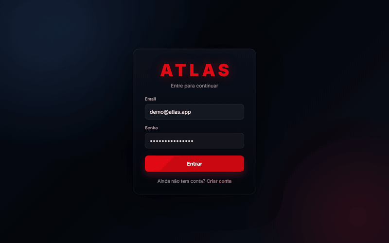
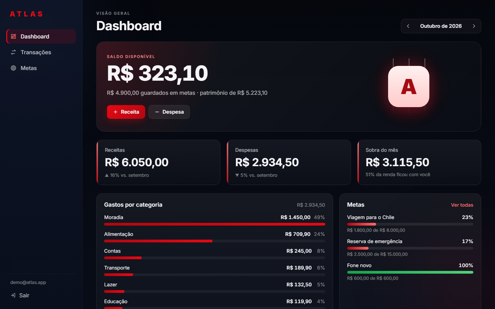
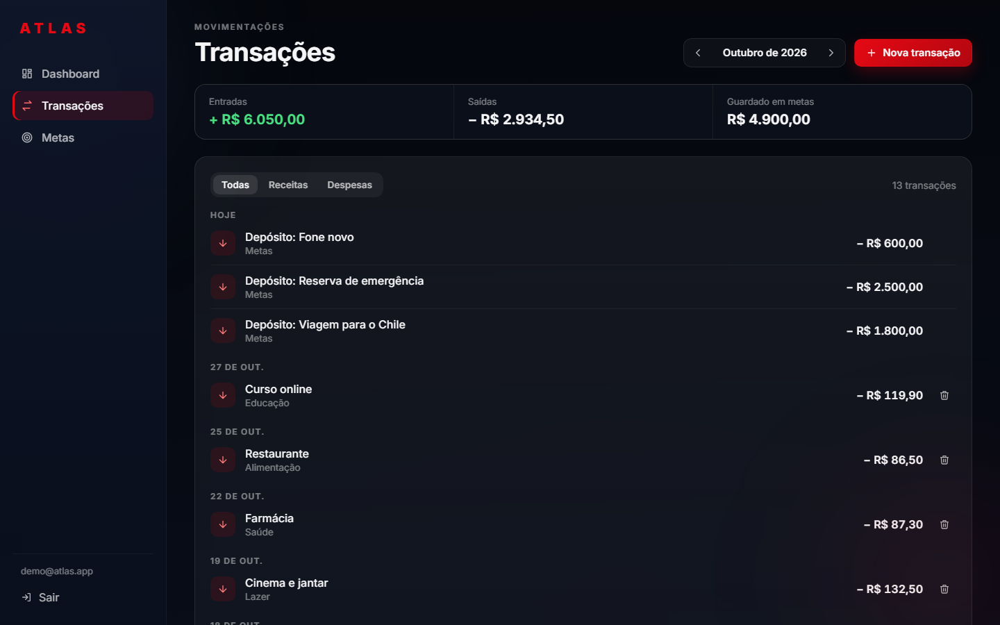
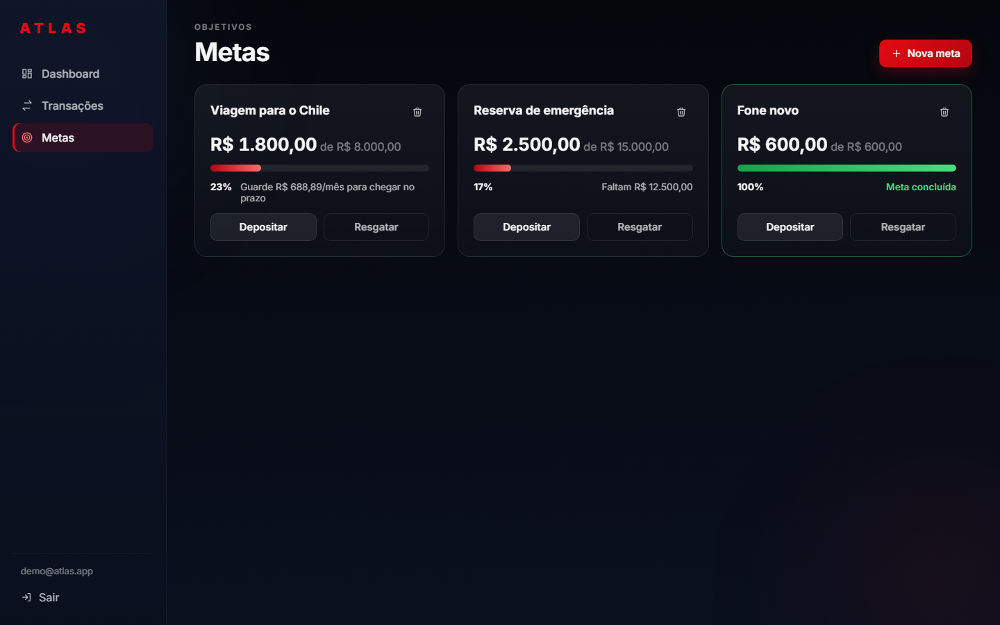
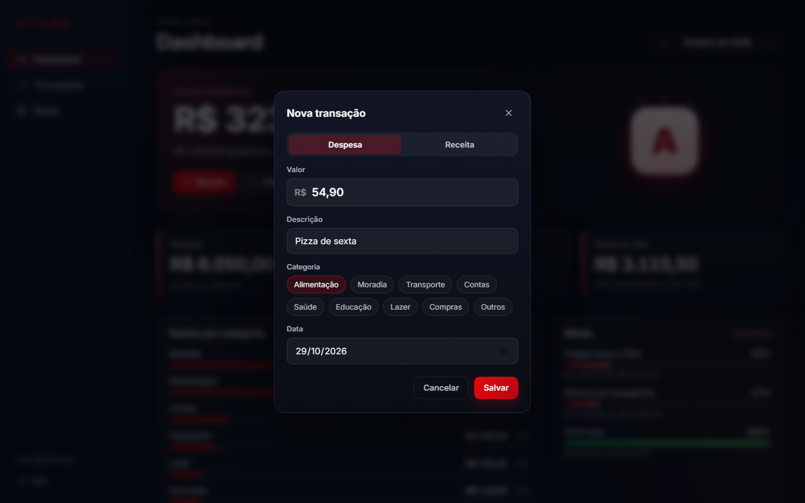
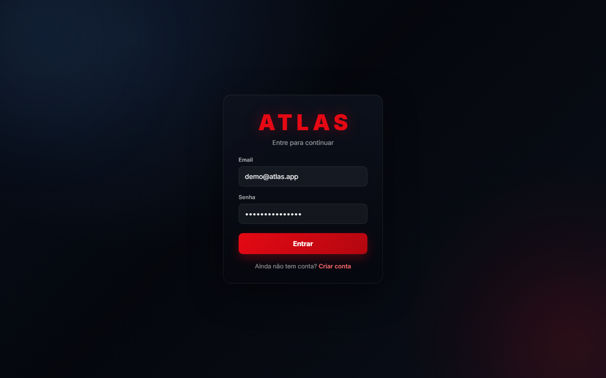
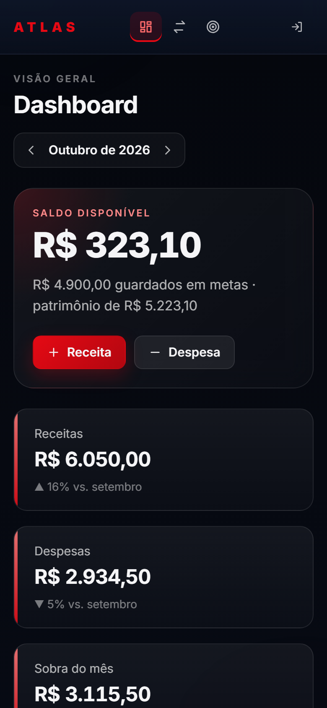
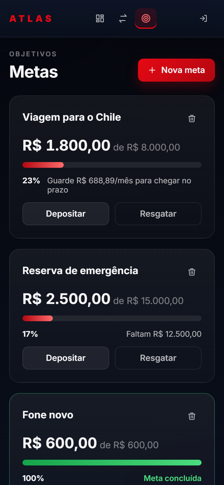

# Atlas — finanças pessoais

Aplicação full-stack para controlar receitas, despesas e metas de economia. Feita com **React**, **Express** e **SQLite**, com autenticação JWT e uma transição animada em que o card de login se transforma no próprio app.

<p align="center">
  
</p>

## Telas

| Dashboard | Transações |
| --- | --- |
|  |  |

| Metas | Nova transação |
| --- | --- |
|  |  |

| Login | Celular |
| --- | --- |
|  |   |

## Funcionalidades

- **Dashboard:** saldo disponível, receitas e despesas do mês comparadas com o mês anterior, quanto da renda sobrou, gastos por categoria, progresso das metas e últimas transações. Dá para navegar entre os meses.
- **Transações:** receitas e despesas com valor, descrição, categoria e data, agrupadas por dia e filtráveis por tipo.
- **Metas:** objetivos de economia com depósito e resgate. Com prazo, o app calcula quanto guardar por mês para chegar lá.
- **Contas:** cadastro e login com senha criptografada. Cada usuário só vê os próprios dados.
- **Responsivo:** no celular a barra lateral vira uma barra no topo.
- **Acessível:** formulários com rótulos, navegação por teclado (Enter envia, Esc fecha modais) e respeito à opção "reduzir movimento" do sistema.

## Decisões técnicas

- **Dinheiro em centavos inteiros.** Todos os valores são guardados como inteiros (R$ 12,34 → `1234`), evitando os erros de arredondamento de ponto flutuante (`0.1 + 0.2 !== 0.3`).
- **Metas são dinheiro guardado, não gasto.** Depositar numa meta tira do saldo disponível, mas não entra nas despesas do mês. Assim os indicadores mostram o que foi realmente gasto.
- **Operações atômicas no banco.** Um depósito atualiza a meta e registra a movimentação dentro da mesma transação do SQLite: ou as duas coisas acontecem, ou nenhuma.
- **Regras garantidas também pelo banco.** Email único, valores positivos e chaves estrangeiras com `ON DELETE CASCADE` ficam no próprio schema, não só no código.
- **Animação medida, não chutada.** A transição de login mede a posição real do card e do logo (inclusive de uma cópia invisível da barra lateral). Por isso funciona em qualquer tamanho de tela, e o fim é disparado pelo `transitionend` em vez de um tempo fixo, o que a mantém precisa mesmo em aparelhos lentos.
- **Segurança:**
  - Senhas com bcrypt.
  - Tokens JWT com validade de 1 hora.
  - O servidor não inicia sem um `JWT_SECRET` forte.
  - Limite de tentativas no login e no cadastro.
  - CORS restrito ao frontend.
  - Erros internos nunca vazam para o navegador.
  - Login com email inexistente e com senha errada dão a mesma mensagem.

## Tecnologias

| Frontend | Backend |
| --- | --- |
| React 19 | Node.js 20.19+ e Express 5 |
| React Router 7 | SQLite (better-sqlite3) |
| Vite | JWT (jsonwebtoken) e bcrypt |
| CSS puro (sem framework) | dotenv e CORS |

## Como rodar

Requisitos: **Node.js 20.19 ou superior**.

```bash
git clone https://github.com/LBMedeiros/Atlas-Finance.git
cd Atlas-Finance

npm run setup   # instala as dependências e gera o backend/.env com um segredo aleatório
npm run dev     # sobe a API e o frontend juntos
```

Abra **http://localhost:5173** e crie uma conta em "Criar conta".

| Comando | O que faz |
| --- | --- |
| `npm run setup` | Instala tudo e cria o `backend/.env` (só se ainda não existir) |
| `npm run dev` | API em `localhost:3000` e frontend em `localhost:5173`, com recarga automática |
| `npm run build` | Gera o frontend de produção em `frontend/dist` |
| `npm start` | Sobe só a API (modo produção) |
| `npm run lint` | Verifica o código do frontend |

Os dados ficam no arquivo `backend/data/atlas.db`, que não vai para o git. Para fazer backup, basta copiar esse arquivo com o servidor parado.

## Variáveis de ambiente

`backend/.env` (gerado pelo `npm run setup`; modelo em [`backend/.env.example`](backend/.env.example)):

| Variável | Obrigatória | Descrição |
| --- | --- | --- |
| `JWT_SECRET` | Sim | Segredo que assina os tokens (mínimo 32 caracteres) |
| `PORT` | Não | Porta da API (padrão `3000`) |
| `CORS_ORIGIN` | Não | Endereço(s) do frontend autorizados, separados por vírgula (padrão `http://localhost:5173`) |
| `DB_PATH` | Não | Caminho do banco SQLite (padrão `backend/data/atlas.db`) |

`frontend/.env` (opcional; modelo em [`frontend/.env.example`](frontend/.env.example)):

| Variável | Descrição |
| --- | --- |
| `VITE_API_URL` | Endereço da API (padrão `http://localhost:3000`) |

## API

Rotas em `/api` exigem o cabeçalho `Authorization: Bearer <token>`. Valores sempre em centavos.

| Método | Rota | Descrição |
| --- | --- | --- |
| `POST` | `/auth/register` | Cria uma conta (`email`, `password`) |
| `POST` | `/auth/login` | Retorna o `token` |
| `GET` | `/api/summary?month=AAAA-MM` | Resumo do dashboard |
| `GET` | `/api/transactions?month=AAAA-MM` | Lista as transações do mês |
| `POST` | `/api/transactions` | Cria (`type`, `amount`, `description`, `category`, `date`) |
| `DELETE` | `/api/transactions/:id` | Exclui |
| `GET` | `/api/goals` | Lista as metas |
| `POST` | `/api/goals` | Cria (`name`, `target`, `deadline` opcional) |
| `POST` | `/api/goals/:id/move` | Deposita ou resgata (`kind`: `deposit` ou `withdraw`, `amount`) |
| `DELETE` | `/api/goals/:id` | Exclui (o valor guardado volta para o saldo) |
| `GET` | `/api/categories` | Categorias de receita e despesa |
| `GET` | `/health` | Verifica se a API está no ar |

## Estrutura

```
├── backend/
│   ├── server.js            # Express: CORS, limites, rotas e tratamento de erros
│   ├── db.js                # Conexão e schema do SQLite
│   ├── routes/
│   │   ├── auth.js          # Cadastro e login
│   │   └── finance.js       # Transações, metas e resumo
│   ├── middleware/
│   │   ├── auth.js          # Validação do JWT
│   │   └── rateLimit.js     # Limite de tentativas por IP
│   └── scripts/setup-env.js # Gera o .env com segredo aleatório
├── frontend/
│   └── src/
│       ├── pages/           # Login, Dashboard, Transações e Metas
│       ├── components/      # Layout, modal, formulários e listas
│       ├── api.js           # Cliente da API
│       └── format.js        # Moeda, datas e meses em pt-BR
└── docs/                    # Imagens deste README
```

## Próximos passos

- Testes automatizados (API e interface)
- Deploy com link público e conta de demonstração
- Categorização automática das transações a partir da descrição
- Exportar transações para CSV

## Autor

Feito por **Lucas Medeiros** · [GitHub](https://github.com/LBMedeiros)
